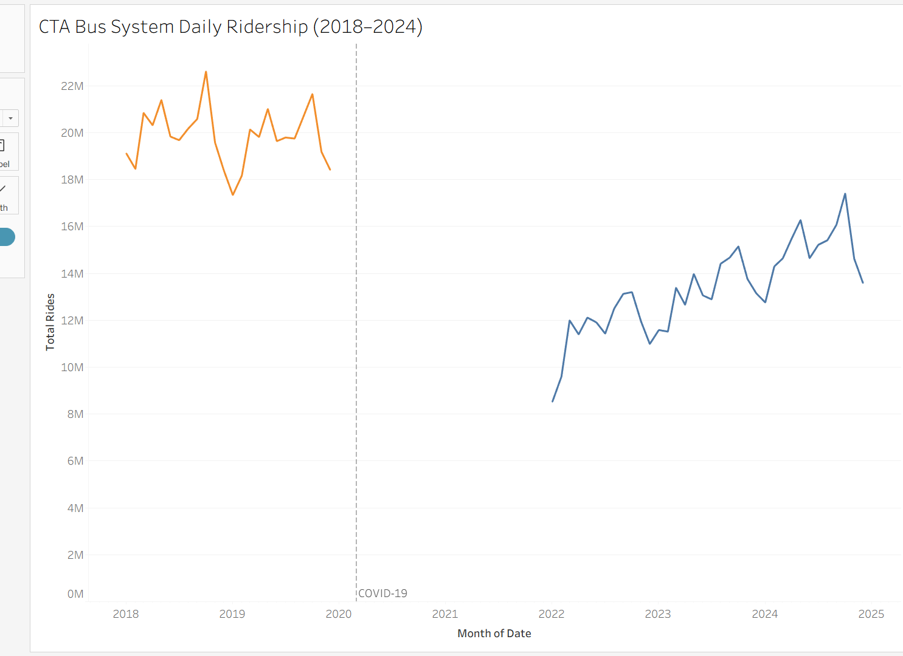
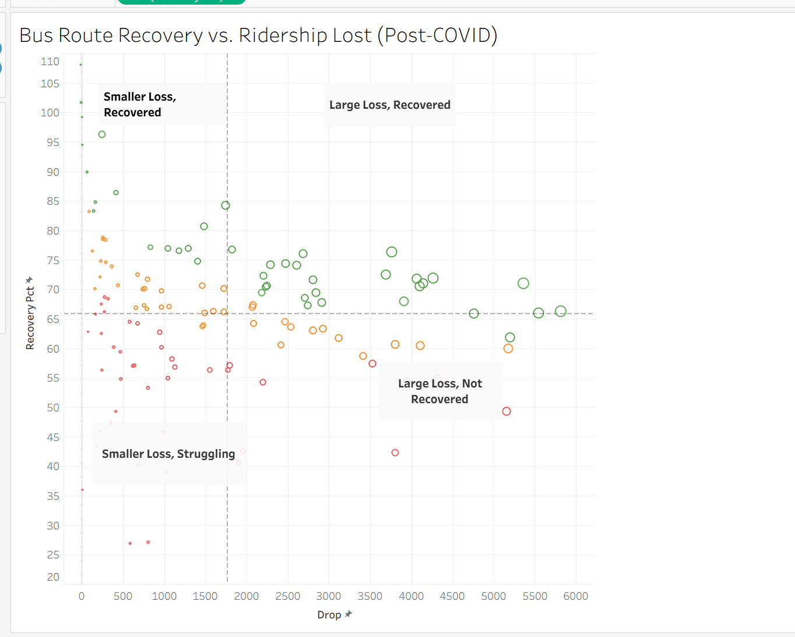
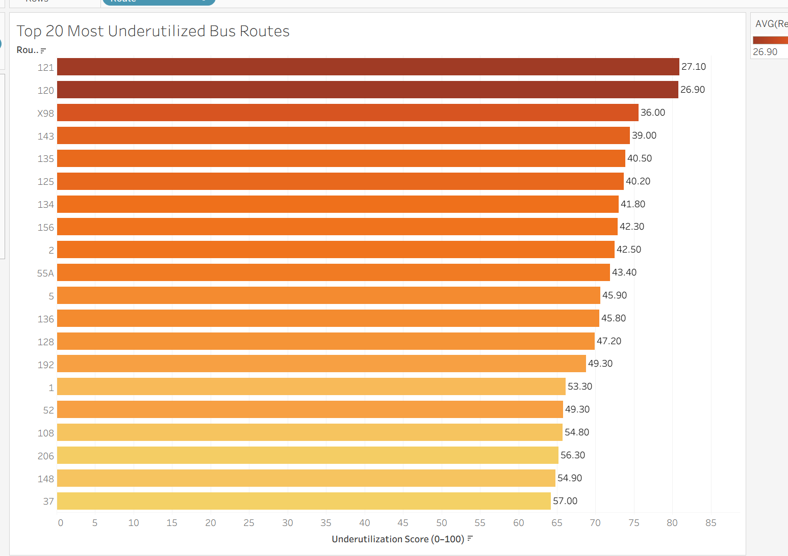
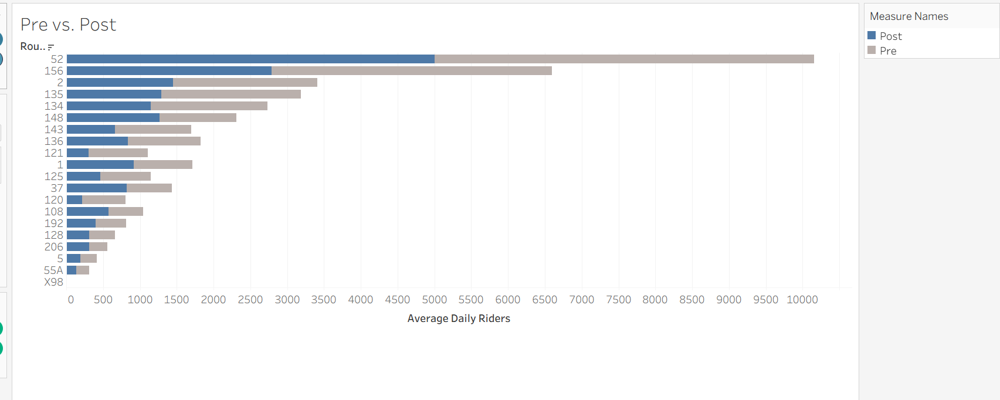
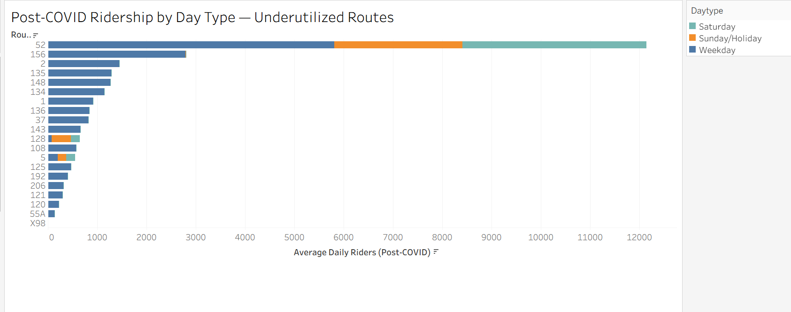

# Filling the Gaps: Identifying Underutilized CTA Bus and Rail Routes

**Prepared by:** Matt Steines
**Date:** March 2026 (revised October 2026)
**Data sources:** Chicago Data Portal: CTA Bus Ridership by Route, CTA 'L' Station Entries

---

## Executive Summary

CTA buses carried 67% of their pre-COVID ridership on average across 2022–2024, climbing from 58% in 2022 to 76% in 2024. The system-wide figure is real progress. Route-level data is less even. This analysis scored 128 bus routes and 143 rail stations using five years of daily ridership data from the Chicago Data Portal and ranked them into three equal tiers. The 43 bus routes and 48 rail stations in the High Risk tier are recovering too, just from a lower starting point and more slowly: the median High Risk bus route reached 62% of its pre-COVID ridership in 2024, while the median Stable route reached 81%. Half of the High Risk bus routes run only on weekdays, and most of the worst performers are express and commuter routes into downtown, a pattern that fits remote and hybrid work better than neighborhood decline. Two Red Line stations, Berwyn and Lawrence, recorded exactly zero entries across all of 2022–2024 after averaging nearly 3,000 daily entries each before COVID. Both stations were closed in 2021 for the Red-Purple Modernization project and did not reopen until July 2025, so what looks like a demand collapse is really a construction closure. The first step is figuring out why the remaining routes are lagging: auditing service levels on High Risk corridors, cross-referencing with equity data to find the communities most exposed, and deciding what commuter service should look like for a hybrid workweek.

---

## 1. Background and context

Between 2018 and 2019, CTA buses averaged 652,921 boardings per day. Across 2022–2024 the average was 437,428, roughly 215,000 fewer per day and 67% of the pre-COVID baseline. The trend inside that window is upward: 58% in 2022, 67% in 2023, and 76% in 2024.

*Figure 1: CTA bus system monthly boardings (2018–2024). Orange = pre-COVID, blue = post-COVID recovery.*

The headline recovery figure hides more than it reveals. It's an average, and the routes underneath it are spread far apart. Size doesn't explain the spread: across all 128 routes, how many riders a route carried before COVID says almost nothing about how well it recovered. What does stand out is the kind of service. Weekday-only routes, most of them built around downtown commutes, have recovered noticeably less than routes that run seven days a week.

Routes running at a fraction of their former ridership still cost money to operate. The CTA received billions in federal pandemic relief through the CARES Act and the American Rescue Plan, which kept service levels intact through the worst of the crisis. Those funds are finite and largely spent. The agency is now facing a structural budget gap with fewer riders, less fare revenue, and no emergency lifeline to fall back on. The pressure to cut underperforming routes isn't hypothetical. It's the next conversation. For residents in neighborhoods where the bus is the primary way to reach work, a clinic, or a grocery store, the difference between a route that gets cut and one that gets restructured is not abstract.

This analysis asked a simple question before that conversation happens: which CTA routes are underperforming, and how badly?

---

## 2. Data and methodology

The analysis draws on two datasets published by the Chicago Transit Authority through the Chicago Data Portal:

- CTA Ridership, Bus Routes, Daily Totals by Route: daily boardings by route and day type (weekday, Saturday, Sunday/holiday)
- CTA Ridership, 'L' Station Entries, Daily Totals: daily entries by rail station. Rail ridership is counted when a rider enters a station, so a transfer between lines inside the system isn't counted twice.

System-wide bus totals are the sum of every route's boardings for each day.

Two time windows define the comparison: 2018–2019 as the pre-COVID baseline, and 2022–2024 as the recovery period. The years 2020 and 2021 were excluded from both windows. They represent the acute crisis period, when ridership collapsed system-wide and many routes were running on emergency schedules. Including those years would muddy both the baseline and the recovery picture. The goal is to compare normal operations before COVID against what the system looks like now, not to measure the depth of the trough.

Each bus route and rail station was scored on a 0–100 composite scale built from three signals. Each signal is rescaled from 0 to 1 across all routes (or all stations) before weighting:

- Post-COVID ridership volume, average daily boardings in 2022–2024 (40%, lower scores worse)
- Recovery rate, the 2022–2024 average as a share of the 2018–2019 average (40%, lower scores worse)
- Absolute ridership drop, average daily boardings lost (20%, larger scores worse)

Averages are taken over the days a route actually ran, so a weekday-only route is averaged across weekdays.

One design choice worth flagging: the score deliberately blends size with proportional loss. Volume on its own would push every small route to the top of the list, and recovery on its own would treat a route that fell from 20 riders to 10 the same as one that fell from 10,000 to 5,000. The drop term pulls large routes that lost a lot of riders back up the ranking. A large route that has lost half its riders is a real failure of service delivery, regardless of how many riders it still has. Focusing only on low-volume routes would miss those cases entirely.

Routes were ranked by score and split into three equal tiers: High Risk, Moderate, and Stable. Because the tiers are thirds by construction, about one-third of routes land in each tier no matter how the system is doing. The tiers say how a route ranks against its peers, not whether it has crossed a fixed threshold. A Stable route has recovered well compared to its peers; that doesn't necessarily mean it's back to full health.

There are real gaps in what this approach can tell us. The datasets don't include service-level data such as route frequency, hours of operation, or schedule changes. A route running every 30 minutes can't realistically attract the ridership of one running every 10 minutes, and this analysis can't separate demand-side decline from supply-side cuts. Where findings suggest a route has collapsed, that warrants direct investigation rather than a simple conclusion about demand. The score also uses three-year averages, so it doesn't capture whether a route is improving; year-by-year recovery is reported separately below. Finally, the two closed Red Line stations stay in the rail scoring. Their 0% recovery stretches the bottom of the recovery scale, and scoring the rail system without them moves 10 of the remaining 141 stations across a tier boundary. The overall rail picture doesn't change.

---

## 3. Findings

### 3a. The system-wide recovery gap

Because the tiers are equal thirds, the counts below describe a ranking rather than a verdict:

| Tier | Bus routes | Rail stations |
|---|---|---|
| High Risk | 43 | 48 |
| Moderate | 42 | 47 |
| Stable | 43 | 48 |
| **Total** | **128** | **143** |

The Stable tier is anchored by major corridors. Western (Route 49), Pulaski (Route 53), and Ashland (Route 9) averaged 71–76% of pre-COVID ridership over 2022–2024 and reached 80–91% in 2024.

The High Risk tier is the concern, but it isn't frozen. The median High Risk bus route went from 49% of its pre-COVID ridership in 2022 to 62% in 2024, and 84% of High Risk routes gained at least five points over that span. The problem is pace. The median Stable route went from 63% to 81% over the same years, so the distance between the two groups grew from about 15 points to about 19. The weakest routes are improving without catching up. Rail shows the same shape: the median High Risk station rose from 43% to 51%, while the median Stable station rose from 56% to 69%.

*Figure 2: Each dot is one route. Horizontal position = average daily boardings lost; vertical position = recovery rate. Color = tier (green = Stable, orange = Moderate, red = High Risk). Size = pre-COVID ridership volume.*

### 3b. Underutilized routes by tier

**High Risk bus routes**

The worst-scoring routes have one thing in common: most of them only run on weekdays. Seventeen of the top 20 in Figure 3 are weekday-only, and most of those are express or Metra connector routes into the Loop.

Route 121 (Union/Streeterville Express) averaged 1,104 daily boardings in 2018–2019. In 2022–2024, that number is 300, a 73% decline with a recovery rate of 27.1%. Route 120 (Ogilvie/Streeterville Express) is nearly identical: from 801 daily boardings to 215, recovering at 26.9%. Route 135 (Clarendon/LaSalle Express) went from 3,186 daily boardings to 1,289, recovering at 40.5%.

These routes exist to move commuters between Metra stations, lakefront neighborhoods, and downtown offices, which is exactly the trip that hybrid work cut back. The ridership data can't prove that's the cause, but the pattern is hard to miss. Across all 128 routes, weekday-only service recovered to a median of 56% of pre-COVID ridership, compared with 68% for routes that run seven days a week. Weekday-only routes make up half of the High Risk tier and only 3 of the 43 Stable routes.

One route worth calling out specifically is Route 52 (Kedzie), because it doesn't fit that pattern. It runs seven days a week, and with roughly 5,000 daily boardings in the post-COVID period, it doesn't look like a struggling route at first glance. But before COVID it was carrying closer to 10,000. That's a 49.3% recovery rate, less than half its former ridership. Its large absolute drop is what keeps it in the High Risk tier despite its size. A route that once carried 10,000 boardings a day and now carries 5,000 isn't fine. It has a hole in it.

*Figure 3: Top 20 bus routes ranked by composite underutilization score (0–100). Bar labels and color show each route's recovery rate (%); darker = lower recovery.*

*Figure 4: Blue = post-COVID average daily boardings. Gray = pre-COVID baseline. The gap between them is what was lost.*

**High Risk rail stations**

Rail tells a more extreme version of the same story, though the most extreme cases have a known cause. Berwyn station on the Red Line averaged 2,845 daily entries in 2018–2019. In the 2022–2024 period, it recorded exactly zero, every single day of the three-year window. Lawrence station, also on the Red Line, averaged 2,762 daily entries before COVID and recorded the identical pattern: zero entries on all 1,096 days.

A flat zero across three full years isn't ridership decline, it's a closed station. Both stops closed in 2021 as part of the CTA's Red-Purple Modernization (RPM) project, a full rebuild of four North Side Red Line stations, and did not reopen until July 20, 2025. The scoring model still flags them as High Risk because the underlying ridership numbers say so, and that's the correct behavior: the model isn't supposed to know why a station went dark, only that it did. But the right response isn't an investigation into the cause. The cause is public record. The right response is tracking whether ridership actually returns now that the stations are open again.

The rest of the High Risk rail tier clusters on lines that feed downtown commuters. Ten of the 48 stations are on the Blue Line's Forest Park branch, nine are on the Evanston and Skokie branches of the Purple and Yellow Lines, and four are downtown Loop stations. It's the same commuter pattern as the bus routes, showing up on a different mode.

**Moderate-tier routes**

The middle tier is less dramatic but harder to read. Bus routes here averaged 57% to 83% of pre-COVID ridership over 2022–2024, with a median of 67%, about where the system sits as a whole. Almost all of them (36 of 42) run seven days a week, and most are still climbing: the tier's median rose from 58% in 2022 to 76% in 2024. Without service-level data, it's hard to say how much further these routes will come back or where they'll level off.

*Figure 5: Post-COVID average daily boardings by day type for the 20 highest-scoring bus routes. Most bars are entirely weekday ridership because most of these routes don't run on weekends.*

Figure 5 makes the commuter pattern easy to see. Seventeen of the twenty bars are weekday boardings and nothing else. Route 156 (LaSalle), the second-busiest route on the chart, has recovered just 42% of its ridership and has no weekend service at all. Cutting routes like this outright would strand the riders who still use them. The more useful question is what size they should be for a workweek where fewer people go downtown five days a week: fewer peak trips, different hours, or consolidation where express routes overlap.

Route 52 tells a different story. It runs seven days a week, and its ridership fell by about the same share on every day type: weekday boardings recovered to 48%, Saturday to 54%, and Sunday to 53%. If remote work were the main cause, the loss would be concentrated on weekdays, and it isn't. The riders haven't shifted to other days; they've left. Combined with its High Risk ranking, Route 52 is one of the routes that most warrants direct investigation before any investment decision is made.

**Stable routes**

The best-performing routes are concentrated in the highest-density corridors and aren't a cause for concern. What they are is a useful reference point. The middle half of Stable bus routes averaged 70–79% of pre-COVID ridership over 2022–2024; the middle half of High Risk routes sat at 46–60%. Both groups improved every year, but the stronger routes improved faster, so two years into the recovery period the gap is wider than it was at the start.

---

## 4. Recommendations

### Recommendation 1: Audit service levels on all 43 High Risk bus routes before cutting any of them

This analysis identifies 43 High Risk bus routes based on ridership outcomes, but it can't determine whether low boardings reflect low demand or inadequate service. A route running every 30 minutes with unreliable on-time performance won't attract riders, and the data here looks identical to a route where neighborhood demand has genuinely declined. Cutting a route that's underperforming because of poor service quality makes the problem worse and damages trust with the riders who still depend on it.

CTA operations should conduct service-level audits for all 43 High Risk routes in the next budget cycle, documenting current frequency, span of service, and on-time performance. For the weekday-only express routes, the audit should also compare the current schedule against which days and hours riders actually use now, since a hybrid workweek may have changed both. Outreach to residents in affected neighborhoods should be part of that process; riders know things that schedules don't capture. The audit is what distinguishes a route that needs investment from one that needs restructuring.

Knowing which situation applies to each route is the precondition for any spending decision.

---

### Recommendation 2: Prioritize recovery investment on High Risk routes serving transit-dependent neighborhoods

A route that dropped from 3,000 daily riders to 800 in a neighborhood with low car ownership is a different problem than the same drop in a corridor where most residents drive. The underutilization score treats both the same.

The 43 High Risk bus routes should be cross-referenced against census data on vehicle ownership, median income, and commute mode. Routes serving high transit-dependency areas with low recovery should be first in line for targeted investment: increased frequency, extended service hours, or schedule restructuring. If the routes that haven't recovered are concentrated in specific communities, which an equity overlay would show quickly, that's not a data pattern. That's a decision someone made, or failed to make, about who gets reliable transit service.

---

### Recommendation 3: Track post-reopening recovery at Berwyn and Lawrence as a reactivation project, not a demand problem

Berwyn and Lawrence stations recorded zero entries on every single day of the 2022–2024 window after carrying roughly 5,600 combined daily entries before COVID. That pattern rules out organic demand shift. Both stations were closed in 2021 for the CTA's Red-Purple Modernization project and reopened July 20, 2025, so the zero-ridership period in this dataset is fully explained by construction, not by riders choosing to leave.

These two stations still deserve attention, just not the kind the raw ridership numbers imply. Former riders spent roughly four years without service at these stops and don't automatically know the stations are open again. Reaching them requires direct outreach in Edgewater and Uptown (transit ads, community organizations, signage at nearby stops that were serving as substitutes), not just a schedule update on the CTA website.

Set a measurable recovery target, something like 60% of pre-2020 entries within 18 months of the July 2025 reopening, and track monthly entry data at both stations against that baseline. If ridership stalls well below that mark a year or more after reopening, that points to a real service or awareness problem worth its own investigation. Right now, the honest read of the data is that these two stations are mid-recovery from a known, finite disruption, and the right move is to measure that recovery, not re-litigate its cause.

---

## 5. Conclusion

Chicago's transit system has recovered from COVID, partially. System-wide bus ridership climbed from 58% of its pre-COVID level in 2022 to 76% in 2024, which is steady progress. Route-level data shows how uneven that progress is. The High Risk third of bus routes and rail stations is improving more slowly than everyone else, and the gap is getting wider. Many of those routes are weekday commuter services whose riders now go downtown less often.

Automatic cuts would be the wrong response, and so would treating every underperforming route the same way. A commuter express that lost riders to hybrid work needs a different fix than a seven-day route like Route 52 where riders left on every day of the week, and both are different from a route that's struggling because of poor service quality. Berwyn and Lawrence are something else entirely: a station closure that the data flags correctly, with a cause on public record and a reopening already underway. What matters now is whether ridership actually comes back now that service has resumed, not relitigating why it dropped in the first place.

The CTA has the ridership data to see where the gaps are. What's been missing is a framework for acting on them at the route level rather than the system level. This analysis tries to build one.

---

*Data: Chicago Data Portal. Analysis period: 2018–2019 (pre-COVID baseline) and 2022–2024 (recovery period). The composite score weights post-COVID ridership volume (40%), recovery rate (40%), and absolute ridership drop (20%) on a 0–100 scale. Code and full methodology: [github.com/msteines0312/cta-analysis](https://github.com/msteines0312/cta-analysis).*
